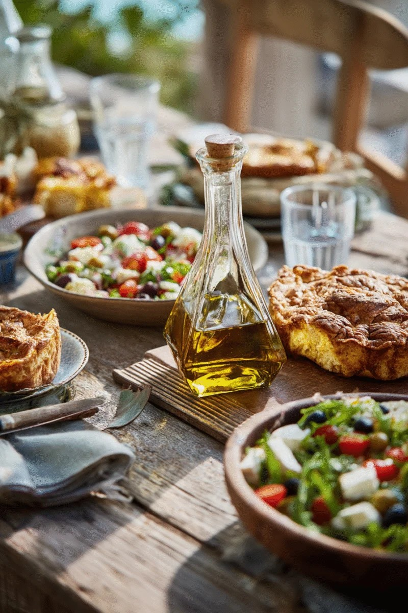

```{r}
#| setup: true

# Load packages
library(tidyverse)
library(knitr)
library(readr)

# Load data
kelly <- read_csv("bargraph.csv")

# Add AI for Omega-3 based on the National Academy of Medicine DRIs
# Source: NIH, Omega-3 Fatty Acids: Fact Sheet for Health Professionals
#         https://ods.od.nih.gov/factsheets/Omega3FattyAcids-HealthProfessional/
kelly$DRIGoal[kelly$Nutrient == "Omega3_g"] <- 1.1

# Correct percentages column
kelly$Percentage <- NA
kelly$Percentage <- as.numeric((kelly$Value / kelly$DRIGoal) * 100)
```

## Kelly

::::{columns}

::: {.column width="60%"}

:::{.fragment}
is a 65 y/o woman with a low activity level. Her goals are to **lose weight** and promote **healthy brain aging**.
:::

:::{.fragment style="margin-top: 2em;"}
Kelly is 5' 3" and weighs 157 lbs. Her BMI is 27.81, which is classified as overweight (>25) but not obese (<30).
:::


:::

::: {.column .fragment width="40%"}

```{r}
#| fig-asp: 1.25

# Plot of weight for height and BMI
bmi <- tibble(
  upper = 25,
  lower = 18.5,
  kelly = 27.81,
  id = "1"
  )

ggplot(bmi, aes(x = id, y = kelly)) +
  geom_point(size = 5, color = "orange") +
  geom_linerange(aes(ymin = lower, ymax = upper)) +
  coord_flip() +
  coord_cartesian(ylim = c(16, 35)) +
  labs(title = "Kelly's BMI",
    subtitle = "Desired range 18.5-25",
    y = "BMI", x = "") +
  theme_classic(base_size = 36) +
  theme(axis.text.x = element_blank(),
    axis.ticks.x = element_blank())
```

:::

::::

# Overall Diet Quality

How balanced is Kelly's diet?

## Comparing food groups {.smaller}

::: {.callout-tip appearance="simple" icon=true}
**Reviewer Note:** Click the tabs below to toggle between MyPlate and Harvard's Healthy Eating Plate recommendations.
:::

::: {.panel-tabset}

### MyPlate

Kelly could consider adding more [fruits]{style="color: darkred;"} and [vegetables]{style="color: darkgreen;"} to her diet, and reducing her intake of [grains]{style="color: darkorange;"} and [protein]{style="color: purple;"}.

```{r}
#| fig-asp: 0.4

# Load data
myplate <- tibble(
  food = c("Grains", "Vegetables", "Fruits", "Dairy", "Protein"),
  volume = c(7.14, 0.66, 1, 0.46, 8.37),
  recommendation = c(5, 2, 1.5, 3, 5),
  percent = (volume / recommendation) * 100
)

# Order food as factor by decreasing percentage
myplate <- myplate %>%
  mutate(food = fct_reorder(food, percent, .desc = TRUE))

# Plot data
ggplot(myplate, aes(x = food, y = percent, fill = food)) +
  geom_col() +
  scale_fill_manual(values = c(
    "Grains" = "darkorange",
    "Vegetables" = "darkgreen",
    "Fruits" = "darkred",
    "Dairy" = "lightblue",
    "Protein" = "purple")) +
  geom_hline(yintercept = 100, linetype = "dashed") +
  labs(title = NULL,
    x = NULL, y = "% of Recommendation") +
  theme_classic(base_size = 18) +
  theme(legend.position = "none")
```

### Harvard

:::: {columns}

::: {.column width="50%"}

Kelly could consider adding more [fruits]{style="color: darkred;"} and [vegetables]{style="color: darkgreen;"} to her diet, and choosing more [healthy protein]{style="color: purple;"}.

:::

::: {.column width="50%"}

#### Beverage Choice {style="text-align: center"}

```{r}
#| fig-pos: center

drink <- tibble(
  drink = c("Water", "Other"),
  amount = c(18, 12.5)
)
 
# Compute percentages
drink$fraction = drink$amount / sum(drink$amount)

# Compute the cumulative percentages (top of each rectangle)
drink$ymax = cumsum(drink$fraction)

# Compute the bottom of each rectangle
drink$ymin = c(0, head(drink$ymax, n=-1))
 
# Compute label position
drink$labelPosition <- (drink$ymax + drink$ymin) / 2

# Compute a good label
drink$label <- paste0(drink$drink, "\n", round(drink$fraction*100), "%")

# Make the plot
ggplot(drink, aes(ymax=ymax, ymin=ymin, xmax=4, xmin=3, fill=drink)) +
  geom_rect() +
  geom_label(x=3.5, aes(y=labelPosition, label=label), size=6) +
  scale_fill_manual(values = c(
    Water = "lightblue",
    Other = "gray"
  )) +
  coord_polar(theta="y") + 
  xlim(c(2, 4)) +
  theme_void() +
  theme(legend.position = "none")

```

:::
::::

```{r}
#| fig-asp: 0.1

healthyplate <- tibble(
  food = c("Vegetables", "Whole Grains", "Fruits", "Healthy Protein", "Other", "Vegetables", "Whole Grains", "Fruits", "Healthy Protein", "Other"),
  intake = c(30, 25, 20, 25, 0, 4+1.2+3, 4.7*5, 5.2, 0.2+2+4.8, 6+2.5+6+6.5+2.4),
  group = c("Recommendation", "Recommendation", "Recommendation", "Recommendation", "Recommendation", "Kelly", "Kelly", "Kelly", "Kelly", "Kelly")
)

# Order food as factor by decreasing percentage
healthyplate <- healthyplate %>%
  mutate(food = fct_relevel(food, "Vegetables", "Whole Grains", "Fruits", "Healthy Protein", "Other"))

# Order group as factor so recommendation comes first
healthyplate <- healthyplate %>%
  mutate(group = fct_relevel(group, "Kelly", "Recommendation"))

ggplot(healthyplate, aes(y = group, x = intake, fill = food)) +
  geom_bar(position = position_fill(reverse = TRUE), stat = "identity") +
  scale_fill_manual(values = c(
    "Vegetables" = "darkgreen",
    "Whole Grains" = "darkorange",
    "Fruits" = "darkred",
    "Healthy Protein" = "purple",
    "Other" = "gray"
  )) +
  theme_void() +
  theme(legend.title = element_blank(),
    legend.position = "bottom",
    axis.text.y = element_text())

```

:::

# Macro- and Micronutrient Intakes

## Macronutrients and Water

Based on daily recommended intakes, Kelly should consider eating less [fat]{style="color: darkred;"} and [protein]{style="color: purple;"}, and drinking more [water]{style="color: blue;"}.

```{r}
#| fig-align: center

macro <- kelly %>%
  filter(Nutrient %in%
      c("Protein_g", "Carbohydrates_g", "Fat_g", "Water_g"))

macro <- macro %>%
  mutate(Nutrient = case_match(Nutrient,
    "Carbohydrates_g" ~ "Carbohydrates",
    "Fat_g" ~ "Fat",
    "Protein_g" ~ "Protein",
    "Water_g" ~ "Water"
    ))

macro <- macro %>%
  mutate(Nutrient = fct_reorder(Nutrient, Percentage, .desc = TRUE))

ggplot(macro, aes(Nutrient, Percentage, fill = Nutrient)) +
  geom_col() +
  scale_fill_manual(values = c(
    "Carbohydrates" = "darkorange",
    "Fat" = "darkred",
    "Protein" = "purple",
    "Water" = "lightblue"
  )) +
  labs(x = NULL, y = "% DRI") +
  geom_hline(yintercept = 100, linetype = "dashed") +
  theme_classic()

```

## Quality of Carbs and Fats {.smaller}

```{r}
carbs <- kelly %>%
  filter(Nutrient %in%
      c("Sugar_g", "AddedSugar_g", "Fiber_g", "SolubleFiber_g", "InsolubleFiber_g"))

fats <- kelly %>%
  filter(Nutrient %in%
      c("SaturatedFat_g", "MonoFat_g", "PolyFat_g", "Cholesterol_mg", "Omega3_g"))

```

:::{.panel-tabset}

### Carbs

::::{columns}

:::{.column width="50%"}

Kelly has done a great job moderating her intake of added sugars and getting a good balance of dietary fiber!

:::{.fragment style="margin-top: 2em;"}
Soluble fiber helps to decrease cholesterol, while insoluble fiber aids in gut motility.
:::

::: {.callout-tip .fragment appearance="simple" icon=true}
**Reviewer Note:** Click the tabs above to toggle between carbs and fats.
:::

:::

:::{.column width="50%"}

```{r}
carbs <- carbs %>%
  mutate(Nutrient = case_match(Nutrient,
    "Sugar_g" ~ "Sugar",
    "AddedSugar_g" ~ "Added Sugar",
    "Fiber_g" ~ "Fiber",
    "SolubleFiber_g" ~ "Soluble Fiber",
    "InsolubleFiber_g" ~ "Insoluble Fiber"
    ))

carbs <- carbs %>%
  rename(
    "Amount (g)" = Value,
    "% DRI" = Percentage
  )

carbs <- carbs %>%
  select(-DRIGoal)

carbs$`% DRI` <- c("", "44%", "119%", "", "")

kable(carbs)

```

:::

::::

### Fats

Kelly did a great job consuming enough Omega-3 fatty acids and cholesterol! However, the large steak she had for dinner and the fried shrimp she had at lunch contributed to an excess intake of saturated and monounsaturated fatty acids.

```{r}
#| fig-asp: 0.4

fats <- fats %>%
  mutate(Nutrient = case_match(Nutrient,
    "SaturatedFat_g" ~ "Saturated Fats",
    "MonoFat_g" ~ "Monounsaturated Fatty Acids",
    "PolyFat_g" ~ "Polyunsaturated Fatty Acids",
    "Cholesterol_mg" ~ "Cholesterol",
    "Omega3_g" ~ "Omega-3"
    ))

fats$stoplight <- c("Reduce", "Reduce", "Increase", "Maintain", "Maintain")
fats$stoplight <- factor(fats$stoplight, levels = c("Reduce", "Increase", "Maintain"), ordered = TRUE)

fats <- fats %>%
  mutate(Nutrient = fct_reorder(Nutrient, Percentage, .desc = FALSE))

ggplot(fats, aes(Percentage, Nutrient, fill = stoplight)) +
  geom_col() +
  geom_vline(xintercept = 100, linetype = "dashed") +
  scale_fill_manual(values = c(
    "Reduce" = "darkred",
    "Increase" = "darkorange",
    "Maintain" = "darkgreen"
  )) +
  labs(x = "% DRI", y = NULL) +
  theme_classic(base_size = 24) +
  theme(legend.title = element_blank())

```

:::


## Vitamins and Minerals {.smaller}

::: {.callout-tip appearance="simple" icon=true}
**Reviewer Note:** Click the tabs below to toggle between vitamins and minerals.
:::

:::{.panel-tabset}

### Vitamins

Kelly's **vitamin D** intake is very low. Her intake of **vitamins A**, **E**, and **folate** are all under 50% of recommended values.

```{r}
#| fig-asp: 0.4

vit <- kelly[21:30,]

vit$Nutrient <- c("Vitamin A", "Thiamin", "Riboflavin", "Niacin", "Vitamin B-6", "Vitamin B-12", "Vitamin C", "Vitamin D", "Vitamin E", "Folate")
  
vit <- vit %>%
  mutate(Nutrient = fct_reorder(Nutrient, Percentage, .desc = TRUE))

ggplot(vit, aes(Percentage, Nutrient)) +
  geom_col(fill = "lightblue") +
  geom_vline(xintercept = 100, linetype = "dashed") +
  labs(x = "% DRI", y = NULL) +
  theme_classic(base_size = 24) +
  theme(legend.title = element_blank())


```

### Minerals

Kelly should make an effort to reduce her intake of **sodium**. Kelly's intake of **calcium**, **magnesium**, and **potassium** were all below recommended values.

```{r}
#| fig-asp: 0.4

min <- kelly[31:37,]

min$Nutrient <- c("Calcium", "Iron", "Magnesium", "Phosphorous", "Potassium", "Sodium", "Zinc")

min <- min %>%
  mutate(Nutrient = fct_reorder(Nutrient, Percentage, .desc = TRUE))

ggplot(min, aes(Percentage, Nutrient)) +
  geom_col(fill = "darkorange") +
  geom_vline(xintercept = 100, linetype = "dashed") +
  labs(x = "% DRI", y = NULL) +
  theme_classic(base_size = 24) +
  theme(legend.title = element_blank())

```

:::

# Goals and Recommendations

## Concerns for Older Adults {.smaller}

Older adults are at an increased risk for...

:::{.fragment .fade-in}
- **vitamin D** deficiency, especially in fall and winter.
:::

:::{.fragment .fade-in}
- insufficient **calcium** intake.
:::

:::{.fragment .fade-in}
- **dehydration**, especially when mobility has decreased.
:::

:::{.fragment .fade-in}
- **vitamin B-12** deficiency due to impaired absorption, even when they are consuming an adequate amount.
:::

:::{.fragment .fade-in}
- excess intake of **sodium** and insufficient intake of **potassium**, which increase the risk of hypertension and cardiovascular outcomes.
:::

::: {.fragment .callout-warning style="margin-top: 2em;"}
## Be aware!

These are all potential concerns for Kelly given her food diary.
:::

## Kelly's goals {.smaller}

::: {.callout-tip appearance="simple" icon=true}
**Reviewer Note:** Click the tabs below to toggle between recommendations for Kelly's two goals.
:::

:::{.panel-tabset}

### Weight Loss

Kelly wants to lose weight. Her BMI is 27.8, which is in the range of overweight, but not obese. BMI is an imperfect measure, but we can still support Kelly's weight loss goals as part of an overall picture of developing healthier habits.

:::{.fragment .fade-up}
- Kelly could work towards her weight loss goal by carefully increasing the amount of low-impact **physical activity** she does, and choosing more **plant-based protein** and **lean meat** instead of fatty meats like steak. 
:::

::: {.fragment .fade-left .callout-warning style="margin-top: 2em;"}
## Be aware!

Some older adults naturally lose weight as they age. After age 70, some of this weight loss is due to *sarcopenia*, or loss of muscle mass, which can lead to functional decline. **Avoid sarcopenia by eating enough healthy protein!**
:::

### Healthy Brain Aging

Kelly wants to make healthy choices to prevent and slow aging-related cognitive decline.

:::{.fragment .fade-up}
- For **Alzheimer's Disease**, regular exercise can reduce risk and aid in treatment. Moderate alcohol consumption may also be protective.
:::

:::{.fragment .fade-up}
- For **vascular dementia**, hypertension, atherosclerosis, and diabetes are all risk factors. Kelly should manage her blood pressure through diet and exercise.
:::

:::

## Recommendations {.smaller}

Kelly can improve her overall health while pursuing her goals of weight loss and healthy brain aging through the following strategies:

:::{.fragment}
**Make simple changes to daily routine by...**

:::{.incremental .fade-up}
- increasing **daily exercise**
- considering **supplements** for vitamin D, calcium, and vitamin B-12.
    - Vitamin D and calcium are both below recommended intakes, placing Kelly at increased risk for osteoporosis and bone fracture.
    - Kelly is consuming plenty of vitamin B-12, but a supplement would provide the vitamin in a more bioavailable form, potentially 
:::

:::

## Recommendations {.smaller}

Kelly can improve her overall health while pursuing her goals of weight loss and healthy brain aging through the following strategies:

:::{.fragment}
**Consume more...**

:::{.incremental .fade-left}
- **healthy proteins** like plant-based sources or lean animal sources such as fish and poultry.
- **potassium-rich foods** like baked potato with skin, spinach, or yogurt to avoid hypertension and vascular dementia.
- **water** to aid in weight loss and in overall health by supporting metabolism.
- **plants**, especially dark green leafy vegetables, to increase intake of B vitamins and folate.
- **nuts and vegetable oils** to increase intake of vitamin E, an imporant antioxidant.
- **orange vegetables** like carrots or sweet potatoes to increase intake of vitamin A to support vision and immune system function.
:::

:::

## Recommendations {.smaller}

Kelly can improve her overall health while pursuing her goals of weight loss and healthy brain aging through the following strategies:

:::: {.columns}

:::{.column .fragment width="65%" style="margin-top: 3em;"}
Overall, Kelly is making a lot of good choices, like eating whole grains and walking every day However, she might take some inspiration from the **Mediterranean diet**, which could support her goals and overall health needs. For a Mediterranean diet food list, meal plans, and links to more resources, see [this article](https://www.health.harvard.edu/healthy-aging-and-longevity/guide-to-the-mediterranean-diet) from Harvard Health Publishing.
:::

:::{.column width="35%"}

:::
::::

# Thank you!


