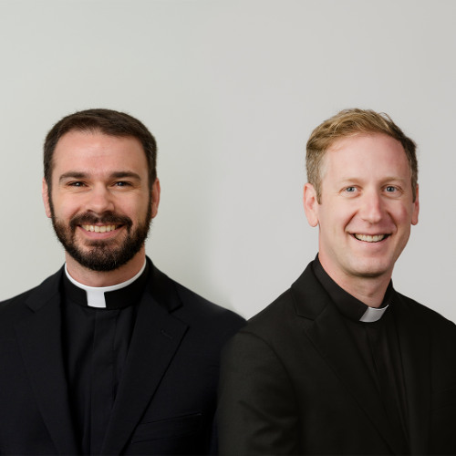

On this episode, Eric talks with Bryan Galligan and Dan Finucane. Dan is a Jesuit of the US Central Southern Province. His Jesuit formation has taken him on a weeklong pilgrimage to Rome for the Synod on Synodality, to Belize, where he accompanied prisoners and to St. Patrick’s Church in West Oakland, California, as both a choir member and a deacon. Bryan is a Jesuit of the US East Province. His Jesuit formation has brought him to the border between the Dominican Republic and Haiti, small-scale farming and fishing communities in eastern and southern Africa and to the United Nations.

As you listen to these stories and reflections from Bryan and Dan, we invite you to consider whether you or someone you know might be interested in discerning a call to Jesuit life. If so, head over to [beajesuit.org](https://beajesuit.org).

Listen to the episode on [Spotify](https://open.spotify.com/episode/5jYr1AGyecLNGu2Z7ZfXUR?si=7SzwsGkCSS2UqNl4RJbjBg), [Apple Podcasts](https://podcasts.apple.com/us/podcast/pathway-to-priesthood-dan-finucane-sj-bryan-galligan-sj/id1473033613?i=1000768101719), or [Soundcloud](https://soundcloud.com/jesuitconference/pathway-to-priesthood-dan?in=jesuitconference/sets/pathway-to-priesthood-2026&utm_source=clipboard&utm_medium=text&utm_campaign=social_sharing).

